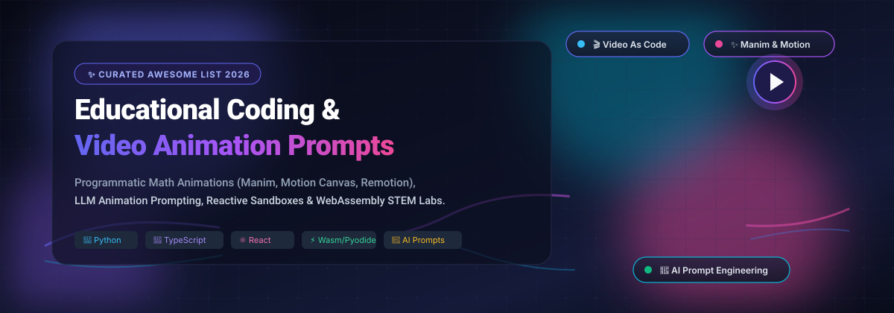

# Awesome-Educational-Coding-Video-Animation-Prompts


  





  
  
  
  
  



# 🎬 Top Educational Coding & Video Animation Prompts

**Curated List of SaaS Platforms & Open-Source GitHub Projects**  
*Focused on Programmatic Math/Code Animation Engines, LLM Animation Prompting, Interactive Browser Coding Sandboxes & Reactive STEM Notebooks*  
**Last updated: November 2026**

This repository tracks notable **SaaS platforms** and **open-source projects** for **Educational Coding & Video Animation Prompts**. These tools power programmatic mathematical and algorithmic animations (3Blue1Brown-style videos), LLM prompt-to-Manim/Motion-Canvas pipelines, browser-based live coding sandboxes, reactive data visualizations, and visual block-coding classrooms for educators, STEM creators, and students.

**Examples** include Replit, Brilliant, Codecademy (Skillsoft), Khan Academy, Observable, CodePen, Glitch (Fastly), Scratch Cloud (MIT), Manim Community (Hosted/Colab workflows), and JupyterLite (the category leaders).

**🚀 Open-source emphasis**: This section is heavily expanded with every major active project for programmatic animation engines (`Manim`, `Motion Canvas`, `Remotion`, `Animotion`, `p5.js`), AI prompt-to-animation generators (`code-animation-prompts`, `Manimator`, `TheoremExplainAgent`), and zero-server WebAssembly coding sandboxes (`JupyterLite`, `Pyodide`, `Marimo`, `Blockly`) — ideal for STEM educators, technical YouTubers, and developers creating visual explainers without proprietary subscriptions.

🤝 Contributions welcome! Open a PR to add/update entries. Keep descriptions factual and link to official sites.

## 📑 Table of Contents
- [📊 Sector Overview & Market Dynamics](#-sector-overview--market-dynamics)
- [☁️ SaaS/Hosted Platforms](#️-saashosted-platforms)
- [💻 Open-Source GitHub Projects](#-open-source-github-projects)
- [🛠️ How to Contribute](#️-how-to-contribute)
- [⚠️ Disclaimer](#️-disclaimer)
- [💖 Support & Thank You](#-support--thank-you)

## 📊 Sector Overview & Market Dynamics

The global EdTech and interactive STEM learning market is valued at approximately **$213B–$215B in 2026**, while the **Interactive Coding Platforms, Creative Code & AI Educational Media** segment accounts for roughly **$9.6B–$11.4B in 2026** (expanding at ~26%–35% CAGR). The sector is **moderately fragmented** across cloud IDEs, interactive STEM courses, and video-as-code studios—with developer cloud sandboxes exhibiting **winner-take-most consolidation** around Replit and CodePen, while programmatic math/code video generation is overwhelmingly led by open-source ecosystems like Manim, Motion Canvas, and Remotion.

## ☁️ SaaS/Hosted Platforms

*Sorted descending by company valuation / annual revenue scale.*

| Platform | Description | Company Scale (Valuation / Revenue) | Starting Paid Tier | Free Tier / Trial Limit |
| :--- | :--- | :--- | :--- | :--- |
| **[Replit](https://replit.com)** | Cloud-native browser IDE and AI coding agent platform enabling instant interactive coding environments, live classrooms, and visual app deployment. | **$1.16B+ Valuation** (~$100M+ est. ARR) | **$20/mo** billed annually ($25/mo monthly for Replit Core) | **Forever Free Starter Plan** (Up to 3 public apps, limited daily AI Agent credits, and shared vCPU/RAM sandboxes) |
| **[Brilliant](https://brilliant.org)** | Interactive STEM learning platform featuring animated visual explanations and hands-on coding, logic, and math simulations. | **~$350M–$500M Est. Valuation** (~$50M+ est. ARR) | **$24.99/mo** (or **$13.49/mo** billed annually at $161.88/yr) | **Forever Free Preview** (Daily free interactive puzzles and first lessons of every STEM course; 7-day Premium trial) |
| **[Codecademy (Skillsoft)](https://codecademy.com)** | Interactive browser-based coding curriculum combining live code editors, visual execution feedback, and AI-guided debugging. | **~$200M+ Segment Revenue** (Acquired by Skillsoft for ~$525M) | **$17.49/mo** billed annually ($209.88/yr Plus) or **$29.99/mo** Pro annual | **Forever Free Basic Plan** (Access to introductory coding chapters and basic interactive exercises; 7-day Pro/Plus trial) |
| **[Khan Academy](https://khanacademy.org)** | Non-profit educational platform featuring live browser-based JavaScript/ProcessingJS drawing, animation, and SQL sandboxes alongside Khanmigo AI. | **$117.5M Annual Revenue** (FY2024–2025 501(c)(3) nonprofit filings) | **$4/mo** (or **$44/yr** for Khanmigo learner plan; $0 for coding sandboxes) | **Forever Free** (100% of interactive ProcessingJS animation sandboxes, CS courses, and mastery exercises free forever) |
| **[Observable](https://observablehq.com)** | Collaborative cloud platform for reactive JavaScript notebooks, D3/Plot animated data visualizations, and interactive technical essays. | **~$50M–$80M Est. Valuation** (~$46M total VC funding) | **$22/editor/mo** for Starter team workspace (or $20/mo Pro individual legacy) | **Forever Free Public Tier** (Unlimited public reactive notebooks, D3/Plot visualizations, and community forks; capped private notebooks) |
| **[CodePen](https://codepen.io)** | Social browser-based front-end coding playground for HTML, CSS, SVG, and Canvas educational animations with live instant previews. | **~$25M–$50M Est. Valuation** (~$5M–$10M est. ARR; profitable) | **$8/mo** billed annually ($96/yr Starter) or **$12/mo** Developer | **Forever Free Plan** (Unlimited public Pens, live browser previews, and 1 public Project with asset upload caps) |
| **[Glitch (Fastly)](https://glitch.com)** | Browser-based full-stack web coding sandbox enabling instant remixing and live hosting of interactive educational web apps and animations. | **Part of Fastly** (Acquired by Fastly; ~$540M+ parent revenue) | **$8/mo** billed annually ($96/yr Glitch Pro) | **Forever Free Plan** (Unlimited public projects with 512 MB RAM, 200 MB disk, and 4,000 container hours/month) |
| **[Scratch Cloud (MIT)](https://mit.edu)** | World's largest free block-based visual coding and interactive animation community created by the MIT Media Lab for learners of all ages. | **Non-Profit Academic Initiative** (MIT Media Lab / Scratch Foundation) | **$0 / Free** (100% grant & donation funded; no paid tier) | **100% Free Forever** (Unlimited cloud-hosted animated stories, games, sprite editors, and remixable community projects) |
| **[Manim Community (Hosted / Colab)](https://manim.community)** | Community-maintained mathematical animation engine commonly run via hosted Google Colab or cloud notebook environments for zero-setup rendering. | **Community Open-Source Project** (01(c)(3) fiscal sponsorship via NumFOCUS) | **$0 / Free** ($9.99/mo optional via Google Colab Pro for faster GPUs) | **100% Free Forever** (Full Manim engine via free Google Colab T4 GPU/CPU runtimes or local installation) |
| **[JupyterLite (Hosted Static Deployments)](https://readthedocs.io)** | Zero-backend WebAssembly JupyterLab distribution hosted on GitHub Pages/ReadTheDocs for instant browser-based Python and interactive plotting. | **Project Jupyter Ecosystem** (NumFOCUS fiscally sponsored) | **$0 / Free** (Runs 100% client-side in the student's browser) | **100% Free Forever** (Unlimited browser-based Python/Pyodide notebooks, Matplotlib/Plotly animations, and static sharing) |

## 💻 Open-Source GitHub Projects

| Project | License / Hosting Cost | Free Tier / Self-Hosted Limit | Description |
| :--- | :--- | :--- | :--- |
| **[Code Animation Prompts (`xiaoyecodes/code-animation-prompts`)](https://github.com)** | **Open-Source** ($0 prompt repository; works with any LLM + Manim/Motion Canvas) | **100% Free forever** (Unlimited educational coding & mathematical video animation prompts and templates) | Curated open-source prompt engineering toolkit for generating clean, structured educational coding and math animation scripts via LLMs. |
| **[Manim Community (`ManimCommunity/manim`)](https://github.com)** | **MIT Open-Source** ($0 Python animation engine) | **100% Free forever** (Unlimited 4K/60fps programmatic math, algorithm, and physics video renders on local hardware) | The industry-standard community-maintained Python animation engine (originated by 3Blue1Brown) for precision mathematical and CS explainers. |
| **[ManimGL (`3b1b/manim`)](https://github.com)** | **MIT Open-Source** ($0 Python OpenGL animation engine) | **100% Free forever** (Unlimited interactive OpenGL shader & live-window mathematical animations locally) | Grant Sanderson's original interactive OpenGL-accelerated version of Manim powering 3Blue1Brown's educational videos. |
